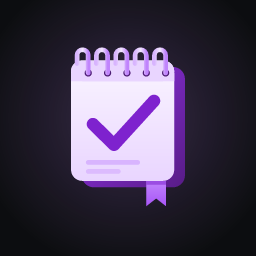

<p align="center"></p>

# Plania

*Renamed from **LifeOS** in 2.0.1.*

An offline personal organizer for Android, part of the Basalt app suite. Tasks, notes, calendar,
habits, journal, expenses, goals and a focus timer in one calm app. No account, no cloud: everything
stays on the phone.

## What's new in 2.2

Everything TaskNote did now lives in Plania:

- **Task categories**: Personal, Work, Grocery, School and General. Pick one in the task editor;
  the Tasks tab shows each category with its open count and filters by it, together with a
  filter box. Rows show their category.
- **Reminder buttons**: reminders have **Mark done** (completes the task, schedules the next round of
  a repeating one, clears the notification) and **Snooze 10 min**. Both work without opening the
  app; an old notification for a task that is already done changes nothing. Tapping the reminder
  opens the task.
- **Swipe on a task**: right to complete, left to delete. Both have Undo; an undone delete comes back
  with its subtasks and reminder.
- **Notes**: Share sends the title, text and checklist to any app. Turn into tasks makes an open task
  from every line (and every unchecked checklist item), after confirming the count.
- **Task insights** (chart icon on Tasks, or More): done today, the streak of days with at least one
  task done, this week's completion rate, overdue tasks, the last 7 days as bars, and open tasks
  by category. Completed tasks from before 2.2 are counted from their last change. Completion
  history is in backups; older backups rebuild it on import.

## What's new in 2.1

- **New logo**: an open planner with spiral rings, a check mark and a bookmark ribbon.
- **Today widget** for the home screen: tasks due today with the first three titles, habits done out
  of the total, and the next event. It updates as soon as you change something in the app, and on its
  own at midnight and when an event ends. While the app lock is on it shows counts and times only.
- **New task tile** in Quick Settings: opens the task editor from anywhere.
- **Launcher shortcuts** (long-press the icon): New task, New note, Start focus.
- **Recurring expenses and income**: mark an entry as repeating weekly or monthly (rent, salary,
  subscriptions). Each occurrence is added on its day, and missed ones are caught up when you open
  Plania, never twice. Expenses > Recurring lists them; tap one to pause, resume or delete it.
- **Encrypted backups**: Export backup asks for a passphrase (or skip it). The file is encrypted
  with AES-256-GCM, with the key derived by PBKDF2-HMAC-SHA256 (210,000 rounds, random salt). Import
  recognises an encrypted file and asks for the passphrase; a wrong one changes nothing. Plain
  backups from 2.0 still import.

## Features

- **Home**: today at a glance. Tasks due today and overdue, habit check-offs, today's events, focus minutes.
- **Tasks**: categories, due date and time, priority, repeat (daily, weekdays, weekly, monthly, yearly),
  reminders with Mark done and Snooze, subtasks, swipe to complete or delete with Undo. Open / Today /
  Upcoming / Done views with category and text filters. Completing a repeating task creates the next one
  (undo removes it). Task insights.
- **Reminders**: local notifications with exact alarms when allowed (inexact fallback), restored after a reboot.
- **Notes**: title, text and checklists, pinning, search, share, turn lines into tasks.
- **Calendar**: month grid with markers, day agenda with events and due tasks, all-day and multi-day events.
- **Habits**: daily check-offs, current and best streaks, a 7-day strip to fix missed days, pause or delete.
- **Journal**: entries with a mood.
- **Expenses**: expenses and income by category, monthly totals, a 6-month trend, per-category budgets,
  weekly or monthly recurring entries that can be paused.
- **Goals**: target date, milestones that drive progress (or manual progress).
- **Focus timer**: 15/25/45/60 minute sessions that survive the app closing, with an end-of-session notification.
- **Search** across everything.
- **Assistant**: a rule-based helper that answers questions about your own data (plan my day, overdue,
  week ahead, spending, habit streaks, goals, focus, mood). It runs on the device, with no internet.
- **Settings**: System/Light/Dark theme, currency symbol, notification status, optional app lock
  (fingerprint, face or phone PIN), quick access help, backup export (optionally encrypted) and import, updates.
- **Quick access**: the Today widget, the New task Quick Settings tile and launcher shortcuts.

## Stack

Flutter, Riverpod, Drift (SQLite), flutter_local_notifications, local_auth, file_picker, cryptography
(pure-Dart AES-GCM and PBKDF2), a little Kotlin for the widget, tile and shortcuts, and the shared
[`basalt`](https://github.com/muhammadahmad545-code/basalt-flutter) package for the design system and updater.

## Permissions — and why

| Permission | Why |
|---|---|
| Notifications, exact alarms, run at startup | Task reminders and the focus timer alarm, restored after a reboot |
| Biometric | The optional app lock (fingerprint, face or phone PIN) |
| Internet, install packages | Checking GitHub for updates and installing them; nothing else goes online |

The widget, the tile and the shortcuts need no extra permission. Version 2.1 adds none.

## Honest limits

- Recurring entries are added by the app itself, so an occurrence appears when Plania next runs on or
  after its day (on start, when you return to it, or at midnight while it is open). Nothing is posted
  in the background while the app is closed.
- Pausing a recurring entry skips the occurrences that fall while it is paused; resuming does not
  add them later.
- The widget keeps a snapshot for today and tomorrow. If Plania is not opened for more than a day it
  says so and asks you to open the app.
- A forgotten backup passphrase cannot be recovered. Unencrypted backups are plain JSON that anyone
  with the file can read.
- Reminder buttons run in the background; if Plania is open at the time, its lists catch up when
  you return to it.
- Insights only know when a task was completed from 2.2 on; earlier completions use the time the
  task was last changed.
- Adding the tile from Settings needs Android 13+, and pinning the widget depends on the launcher;
  otherwise add them by hand.

## Updates

On every launch (and when resumed after 15 minutes) the app checks this repo's GitHub releases. When a
newer version exists, Home shows a card that downloads the APK for the phone's ABI, verifies its SHA-256
and opens the installer. Settings > Updates checks by hand.

## Build

```bash
flutter pub get
dart run build_runner build --delete-conflicting-outputs   # Drift code generation
flutter test
flutter build apk --release --split-per-abi
```

CI (`.github/workflows/build.yml`) runs analysis and tests, builds the APKs, and runs an emulator smoke
test with end-to-end checks (`scripts/smoke.sh`, `scripts/e2e.sh`). Tags `v*` publish a release, signed
with the suite key from repository secrets.

## Upgrading from 1.x

1.x was `com.example.lifeos_ai` with local accounts. 2.0 is `dev.basalt.lifeos`, single-user. The
database migration (schema 5) keeps all rows, assigns them to the local user, rebuilds habit history from
the old streak counters and drops the old accounts table.
